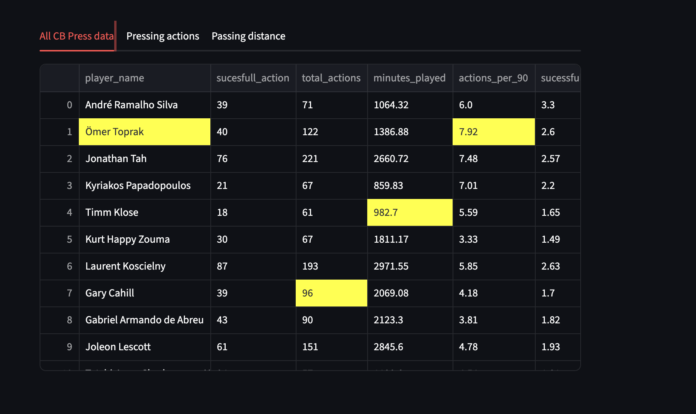

# How to run press model

To run, ensure you are in press-resistance/src directory.

There are a few dependencies needed;
- Pandas
- numpy
- streamlit

these can be installed via pip install Pandas numpy streamlit

You will also need to clone the open-data repository

To run the file 
`% streamlit run main.py`

this will open a app that looks like this 
